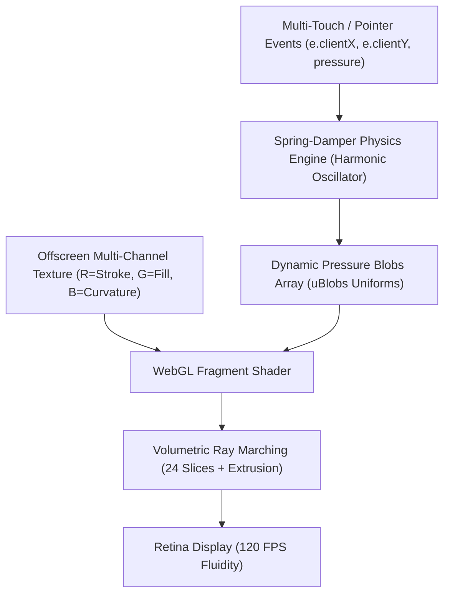

# 🫧 Typography Under Pressure — Interactive Inflatable WebGL

> An ultra-minimalist, black-and-white interactive typography experiment running on raw WebGL and spring-damper physics. Built for iPad multi-touch, desktop interaction, and high-DPI Retina displays.

Inspired by the kinetic typography research of **Schultzschultz** (*"Typography under pressure!"*).

---

## ✦ Live Aesthetic & Interaction

- **Rest State:** Crisp, hollow white contour outlines (`3px stroke`) of **MAX DOESBORGH** on a pitch-black canvas (`#050505`).
- **Under Pressure (Touch / Drag):**
  - **Pneumatic Balloon Inflation:** Letters bulge outward radially with Gaussian falloff where touched.
  - **Stroke-to-Fill Transition:** Hollow outlines inflate dynamically into voluptuous, solid white forms.
  - **Stepped 3D Extrusion Stack:** 24 depth slices march downwards in the GPU shader, creating rhythmic zebra-striped depth contours.
  - **Spring-Damper Physics:** Harmonic oscillation causes the letters to bounce, wobble, and jiggle back elastically when released.

---

## 🔬 Creative Coding Architecture



### 1. Multi-Channel Texture Rasterization
The typography is rendered once to an offscreen canvas and encoded across color channels:
- **Red Channel:** Sharp hollow vector outline stroke.
- **Green Channel:** Solid letter silhouette.
- **Blue Channel:** Specular curvature map for 3D highlights.

### 2. Spring-Damper Harmonic Oscillator
Each active touch point follows an elastic spring equation:
$$\text{Force} = (\text{targetPressure} - \text{pressure}) \cdot k$$
$$\text{velocity}_{\text{pressure}} = (\text{velocity}_{\text{pressure}} + \text{Force}) \cdot \text{damping}$$
$$\text{pressure} += \text{velocity}_{\text{pressure}}$$

### 3. GPU Volumetric Slicing (GLSL)
The fragment shader marches 24 depth layers ($z = 1.0 \rightarrow 0.0$):
```glsl
vec2 sliceUV = uvDisplaced + extrudeVector * z;
float band = mod(z * 18.0, 2.0);
float shade = (band > 1.0) ? 0.95 : 0.08;
```

---

## 🎛️ Tunable Creative Coding Parameters

In [`main.js`](./main.js), you can experiment with the `PARAMS` object:

| Parameter | Default | Effect |
| :--- | :--- | :--- |
| `maxPressure` | `1.6` | Peak inflation power (increase for massive bulbous balloons) |
| `pressureRadius` | `0.22` | Interaction diameter around the fingertip |
| `bulgeStrength` | `0.065` | How far letters physically displace outwards |
| `springStiffness` | `0.14` | Return speed (higher = snappier, lower = lazy) |
| `springDamping` | `0.82` | Elasticity (lower like `0.65` = juicy jelly wobble) |
| `extrusionSlices`| `24` | Depth resolution of the 3D relief |
| `extrusionDepth` | `0.08` | Length of the downward 3D shadow block |
| `contourBands` | `18.0` | Density of the black-and-white contour stripes |

---

## 🚀 Getting Started

### 1. Installation
Clone the repository and install dependencies:
```bash
git clone https://github.com/maxdoesborgh/ipad-visual-touch.git
cd ipad-visual-touch
npm install
```

### 2. Run Locally
Start the Vite development server with host broadcasting:
```bash
npm run dev
```

### 3. Testing on iPad
1. Connect your iPad to the **same Wi-Fi network** as your computer.
2. Check your laptop's local IP (e.g., `192.168.1.4`).
3. Open Safari on your iPad and navigate to:
   ```text
   http://<YOUR-LAPTOP-IP>:5173
   ```
4. *(Optional)* Tap the **Share** button in Safari and choose **"Add to Home Screen"** to run it as a 100% fullscreen web app without browser bars.

---

## 🛠️ Tech Stack
- **Engine:** Vanilla JavaScript + WebGL (GLSL)
- **Typography:** [Syne](https://fonts.google.com/specimen/Syne) (800 Extra-Bold) & [Space Grotesk](https://fonts.google.com/specimen/Space+Grotesk)
- **Styling:** Modern Vanilla CSS (Zero dependencies, strict gesture locking)
- **Bundler:** Vite

---

## 👤 Author
**Max Doesborgh**  
Creative Technologist & Digital Director  
Fontys University of Applied Sciences  
GitHub: [@maxdoesborgh](https://github.com/maxdoesborgh)
